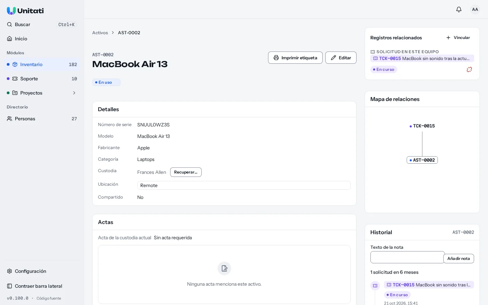
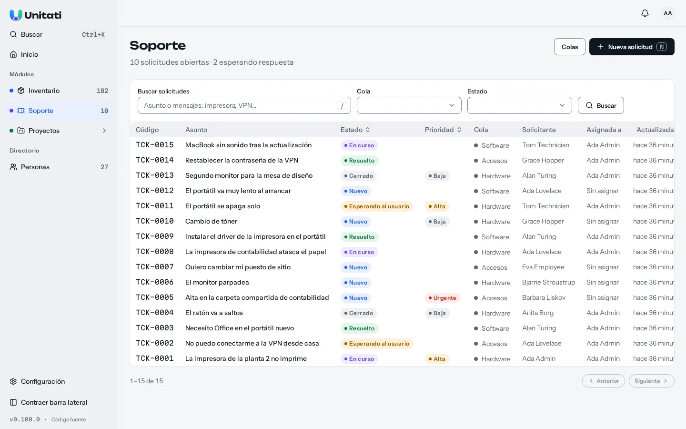
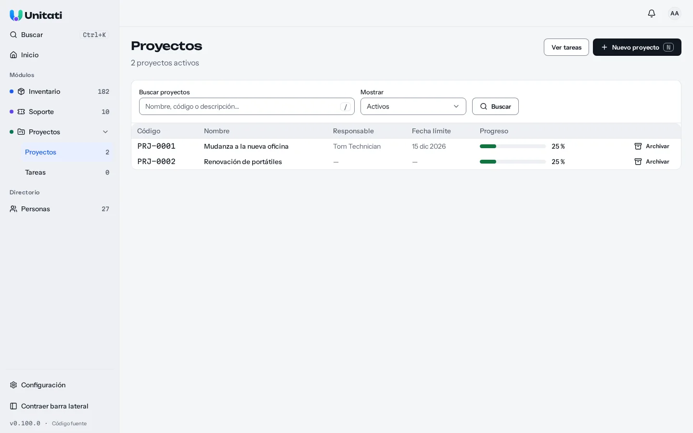
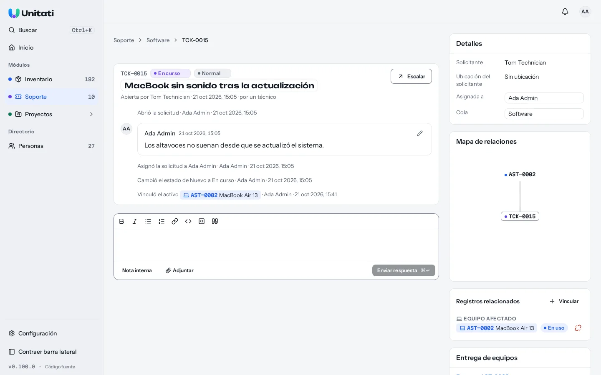
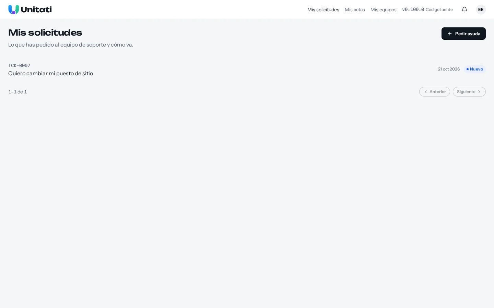

<p align="center">
  
</p>

<h1 align="center">Unitati</h1>

<p align="center">
  Projects, service desk and IT asset management for internal IT teams, on one data model.
</p>

<p align="center">
  
  
  <a href="LICENSE"></a>
</p>



_A laptop, its custodian and the support request about it — together on one record. [More screenshots](#screenshots)._

## Why Unitati?

Internal IT teams usually run three separate tools: one for **projects**, one for **tickets** and
one for **assets**. The real cost is not three tabs. It is **disconnected data**:

1. **Three directories.** The same people exist three times, with three logins and permission models.
2. **No context.** A ticket does not know which laptop it is about, and the laptop does not show its incident history.
3. **No continuity.** A recurring issue is handled in a ticket but planned as project work somewhere else.

Unitati connects these records instead of making your team maintain the same context in three
places:

| Connection             | What it lets you do                                                      |
| ---------------------- | ------------------------------------------------------------------------ |
| Ticket ↔ Asset         | Open a request about a laptop, then find that request from the laptop    |
| Asset → ticket history | See recurring incidents before deciding whether to repair or replace it  |
| Ticket → Task          | Escalate an issue into planned work without losing the original request  |
| Ticket → Project       | Attach a request to the project handling it                              |
| Person → records       | Find a person's equipment, requests and assigned work from one directory |

## What you can do today

- **Inventory:** register and find assets, manage models and locations, assign and reclaim
  custody, print labels, and follow each asset's history. Import people and assets from CSV.
- **Service desk:** accept requests through an employee portal, work them in queues, assign
  technicians, reply publicly or privately, attach files and notify people by email when mail is
  configured.
- **Projects:** plan projects and tasks on a board, assign owners and track progress. Escalate a
  ticket to a task or a project and keep the records connected.
- **One directory and search:** manage people, teams, departments and locations; search across
  people, assets, tickets and project work with role-based access.
- **Knowledge base:** write documentation once, in spaces with a page tree and revision history.
  Staff discuss pages in comments with mentions; employees read the pages of `portal` spaces,
  and the portal suggests relevant pages while they write a request. Tickets cite pages and
  projects link their documentation, so runbooks, how-tos and project docs live in one place.
- **Handovers and requests:** record equipment handovers, request signatures, and let employees
  ask for equipment from the portal.
- **Notifications and API:** in-app notifications with mentions and followers, and a REST API
  (`/api/v1`, with an OpenAPI document) authenticated with API keys.

The interface is **currently in Spanish only**. English code and documentation do not imply an
English UI. See the [roadmap](docs/roadmap-v1.md) for planned work; for example, directly linking
a project to an asset batch is **post-v1**, not a current feature.

## Status

**v1.0.0, still in evaluation.** Inventory, service desk, projects, the knowledge base and their
ticket-based links are implemented, and the `/api/v1` contract is stable: a change to a status or
an error code is a breaking change and bumps the major version. The original [MVP walkthrough](docs/mvp-scope.md#exit-criterion) is a manual check,
not an end-to-end CI test, and the current seed does not yet reach its planned volume (15 tickets
rather than about 80). Use the [changelog](CHANGELOG.md) for shipped changes and the
[roadmap](docs/roadmap-v1.md) for what comes next.

## Try it locally

Requires Docker and Compose v2 (`docker compose` or `docker-compose`) and OpenSSL. In a fresh clone:

```sh
git clone https://github.com/NauelG/unitati.git
cd unitati
printf 'POSTGRES_PASSWORD=%s\nBETTER_AUTH_SECRET=%s\n' \
  "$(openssl rand -hex 32)" "$(openssl rand -hex 32)" > .env.production
docker compose --env-file .env.production -f docs/deploy/compose.yaml up -d --wait
```

Open **<http://localhost:8080/setup>** to create the organisation and first administrator. This
uses the [public container image](https://github.com/NauelG/unitati/pkgs/container/unitati)
without a registry login; `UNITATI_IMAGE` in `.env.production` can select a specific tag. The
example includes Postgres, persistent volumes and a local reverse proxy so forms work over HTTP.
For an internet-facing installation, HTTPS, backups, mail and upgrades, read the
[self-hosting guide](docs/self-hosting.md). To stop the local stack, run the same command with
`down` instead of `up -d --wait` (leave off `--volumes` to keep your data).

## Screenshots

| Service desk                                                                          | Projects                                                             |
| ------------------------------------------------------------------------------------- | -------------------------------------------------------------------- |
|  |  |

| Ticket and asset link                                                             | Employee portal                                                      |
| --------------------------------------------------------------------------------- | -------------------------------------------------------------------- |
|  |  |

[Inventory](docs/screenshots/inventory.webp) · [People directory](docs/screenshots/directory.webp)

## Documentation and contributing

- [Self-hosting and operations](docs/self-hosting.md) · [Contributor setup](.github/CONTRIBUTING.md)
- [Product vision](docs/vision.md) · [Domain model](docs/domain-model.md) · [Architecture decisions](docs/adr/)
- [MVP scope](docs/mvp-scope.md) · [Roadmap](docs/roadmap-v1.md) · [Changelog](CHANGELOG.md)

Contributions use Conventional Commits and a [DCO sign-off](.github/CONTRIBUTING.md#license-and-sign-off)
(`git commit -s`).

## License

Copyright © 2026 Nauel Gómez and contributors. Unitati is licensed under the
[GNU Affero General Public License v3.0 only](LICENSE). Installations that modify Unitati and
serve it over a network must offer their users the corresponding source code; the "Código fuente"
link next to the running version supports that obligation ([ADR 0041](docs/adr/0041-license-agpl-3.0-only.md)).
