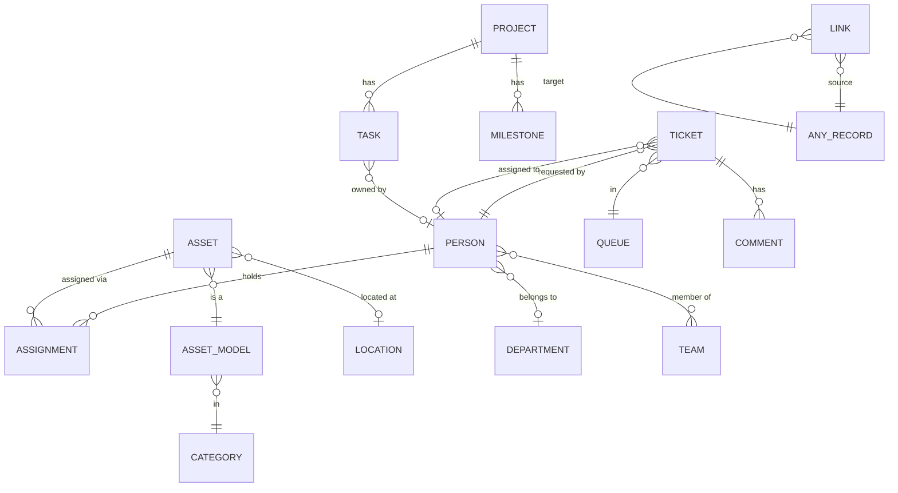
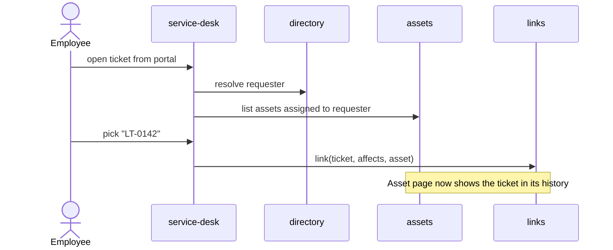
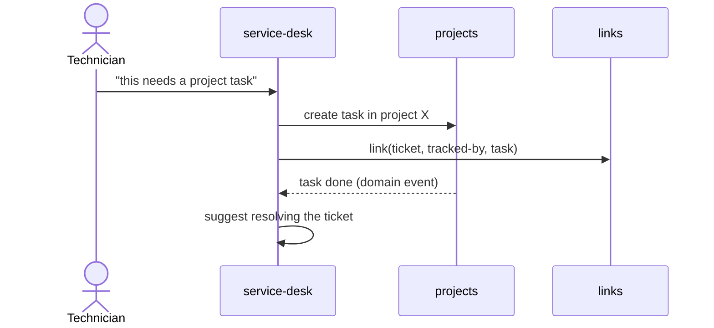
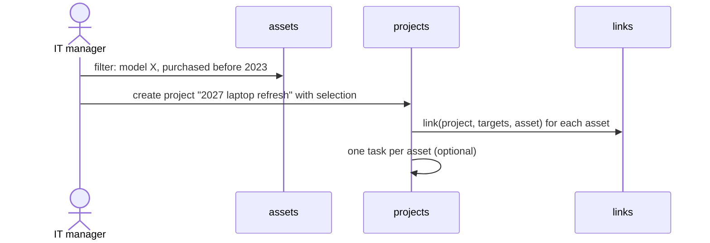

# Domain model

Draft. Names here become folder names in `src/lib/server/<domain>/` (see [ADR 0002](adr/0002-server-modules-by-domain.md)).

## Domains

| Domain         | Owns                                                                                  |
| -------------- | ------------------------------------------------------------------------------------- |
| `directory`    | `Person`, `Team`, `Department`, `Location`                                            |
| `assets`       | `Asset`, `AssetModel`, `Category`, `Assignment`, `Kit`; later `License`, `Consumable` |
| `service-desk` | `Ticket`, `Queue`, `Comment` (public / internal), `CannedResponse`; later `Sla`       |
| `projects`     | `Project`, `Milestone`, `Task`, `Board`, `Column`; later `TimeEntry`                  |
| `links`        | `Link`: a typed relation between two records of any domain                            |
| cross-cutting  | `ActivityLog`, `Attachment`, `CustomField`, global search                             |

`directory` is the only domain everyone depends on. The other three domains do not import each other's tables; they relate through `links`.

## Core entities

## The `Link` entity

A single table for cross-domain relations:

| Column       | Example                                      |
| ------------ | -------------------------------------------- |
| `sourceType` | `ticket`                                     |
| `sourceId`   | `T-1042`                                     |
| `targetType` | `asset`                                      |
| `targetId`   | `LT-0142`                                    |
| `kind`       | `affects`, `caused`, `tracked-by`, `targets` |
| `createdBy`  | person id                                    |
| `createdAt`  | timestamp                                    |

Allowed `(sourceType, kind, targetType)` triples are declared in code, not free-form:

| Source  | Kind         | Target | Meaning                                   |
| ------- | ------------ | ------ | ----------------------------------------- |
| ticket  | `affects`    | asset  | The ticket is about this device           |
| ticket  | `tracked-by` | task   | The ticket's resolution is a project task |
| task    | `targets`    | asset  | The task acts on this device              |
| project | `targets`    | asset  | The asset is in the project's scope       |
| ticket  | `duplicates` | ticket | Duplicate tickets                         |

**Tradeoff:** a polymorphic table cannot use real foreign keys. The alternative is one join table per pair (`ticket_asset`, `ticket_task`, …), which gives database integrity but more tables and more code per new relation. Decide in the first vertical slice. The polymorphic table is the default because it keeps the domains decoupled and powers a generic "related items" panel.

## Key cross-domain flows

### Ticket about a device

### Ticket escalated to project work

### Refresh project from inventory

