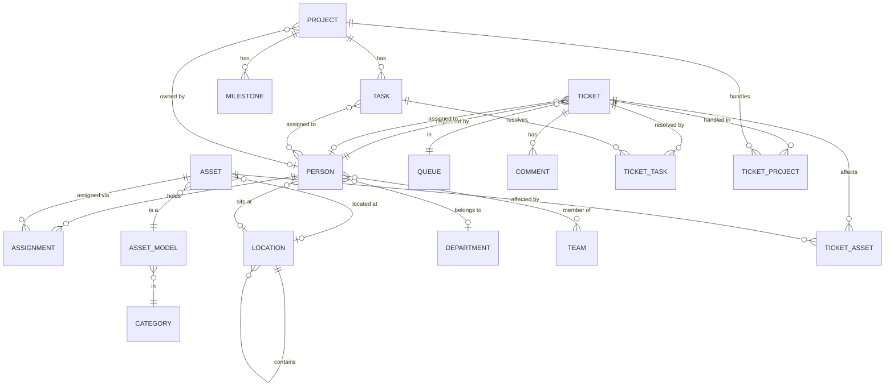
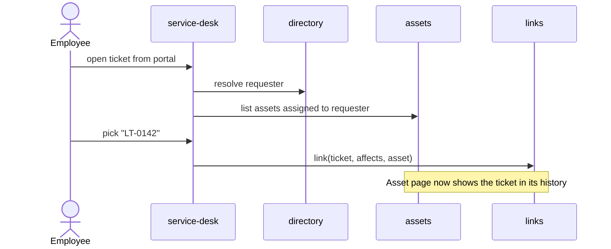
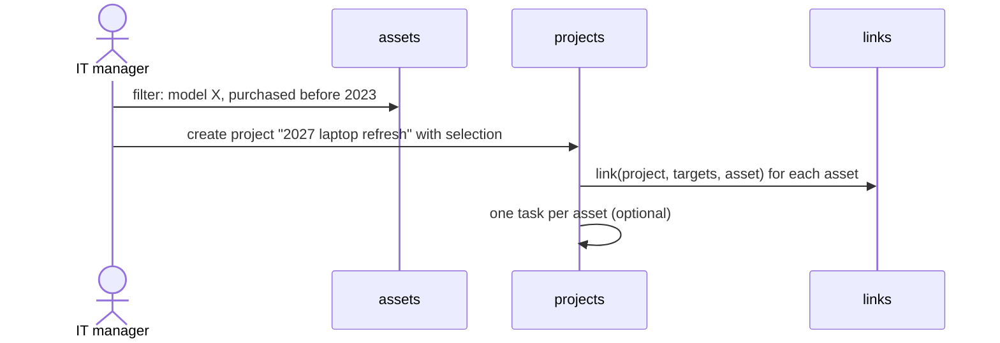

# Domain model

Draft. Names here become folder names in `src/lib/server/<domain>/` (see [ADR 0002](adr/0002-server-modules-by-domain.md)).

## Domains

| Domain         | Owns                                                                                             |
| -------------- | ------------------------------------------------------------------------------------------------ |
| `directory`    | `Organisation`, `OrganisationBranding`, `BrandAsset`, `Person`, `Team`, `Department`, `Location` |
| `assets`       | `Asset`, `AssetModel`, `Category`, `Manufacturer`, `Custody`; later `Kit`, `License`             |
| `service-desk` | `Ticket`, `Queue`, `Comment` (public / internal); later `CannedResponse`, `Sla`                  |
| `projects`     | `Project`, `Task`, `State` + `StateGroup`; later `Milestone`                                     |
| `links`        | the pairwise join tables and the uniform read facade over them                                   |
| `api`          | `ApiKey`, `ServiceAccount`; the `/api/v1` endpoint registry                                      |
| cross-cutting  | `ActivityLog`, `Attachment`, global search                                                       |

`directory` is the only domain everyone depends on. The other three domains do not import each other's tables; they relate through `links`.

The **brand** is how an organisation presents the product: its product name, colour and logos ([ADR 0026](adr/0026-per-organisation-branding.md)). A brand is **customised** when it differs from Unitati's default; from then on Unitati's own art never shows, and a text wordmark and a monogram stand in until logos are uploaded. A **brand asset** is one processed image in a slot: the admin uploads the `lockup`, `lockup_dark` and `mark`; the `favicon` and `apple_touch` icons are **derived** from the mark and never uploaded. Only the processed output is stored. **Powered by** is the fixed attribution to Unitati shown beside a customised brand; it cannot be turned off.

A **location** is a place, nested without types: a building contains floors, a floor contains rooms ([ADR 0027](adr/0027-locations-hierarchy-coordinates-and-deletion.md)). Its **path** (`Barcelona office › Floor 1`) is how it is shown, because a name is only unique among siblings. Its **code** (`BCN-1`) is a short identifier unique in the whole organisation, and it may have coordinates, both latitude and longitude or neither. An asset's location cannot be deleted from under it; a person's can.

A person's location is where they usually work: one per person, any node of the tree. It is informative and independent of the custody of their assets, and Unitati owns it whatever channel wrote it. Only `people.manage` changes it, and every change is recorded as `person.location.changed`.

`Organisation` exists so the schema is tenant-ready while exactly one row is used: every aggregate root carries `organisation_id` ([ADR 0004](adr/0004-tenancy.md)).

`State` carries a user-chosen name and a system-owned `StateGroup` (`backlog`, `unstarted`, `started`, `completed`, `cancelled`). That split is how a catalogue stays configurable while the structure does not — the shape Plane uses. The group is fixed when a state is created and never changes; code depends on the group, never on the name. A `Task` sits in exactly one `State`, and its board column is ordered by a fractional `position`.

A project is **archived** rather than deleted, and an archived project (with its tasks) is read-only. A task has **assignees** — any number of people — and a project has at most one owner.

A **service account** is an organisation-owned API principal with the technician or employee role and no `Person` ([ADR 0022](adr/0022-api-layer-and-api-keys.md)). It is disabled, never deleted, because the `ActivityLog` entries it wrote name it as their actor (a row has a person, a service account, or neither for the system, never both).

`CustomField` is deliberately absent: it is post-v1 in the [roadmap](roadmap-v1.md).

## Core entities



## Cross-domain relations

One join table per pair, each with real foreign keys, all owned by `links`
([ADR 0005](adr/0005-single-suite-and-relations.md)):

| Table            | Relation                    | Panel label   | Meaning                                              | Tier    |
| ---------------- | --------------------------- | ------------- | ---------------------------------------------------- | ------- |
| `ticket_asset`   | ticket `affects` asset      | _Affects_     | The ticket is about this device                      | MVP     |
| `ticket_task`    | ticket `resolved-by` task   | _Resolved in_ | A task carries the work that resolves the ticket     | MVP     |
| `ticket_project` | ticket `handled-in` project | _Handled in_  | The ticket is attended within this programme of work | MVP     |
| `project_asset`  | project `targets` asset     | _Targets_     | The asset is in the project's scope                  | post-v1 |

Each row also carries `createdBy` and `createdAt`, so a relation can be attributed like any
other record. Every one of these tables carries a **composite unique constraint on its pair**:
merge and split ([#20](../../issues/20)) moves a losing record's links onto the winner, and
without the constraint a link the winner already held lands twice.

The **Relation** column is domain vocabulary, not schema. There is no `kind` column: ADR 0005
made the relation _be_ the table, so a verb here names a meaning for people and for panel
labels, never a value stored in a row. Looking for `kind` in the database is looking for
something that was deliberately removed.

A ticket escalates to a task _and_ to a project because those answer different questions —
_"what work resolves this"_ versus _"what programme is this attended under"_. The second exists
because a request that justifies a whole project has no task to point at yet. See the
[amendment to ADR 0005](adr/0005-single-suite-and-relations.md#amendment-2026-10-07-ticket--project)
for the products this was checked against.

`links` exposes one read function, `relatedTo(record)`, which is what the design system's
`RecordRef` and `RelatedRecords` components consume. **The interface is uniform; the storage
is not** — and conflating those two is what makes polymorphic link tables look inevitable.

The guarantee this buys: the database cannot hold a ticket pointing at an asset that does
not exist. No foreign key can protect a column that sometimes means `assets` and sometimes
`tasks`, which is why the earlier polymorphic draft was dropped.

## Key cross-domain flows

### Ticket about a device



### Ticket escalated to project work

```mermaid
sequenceDiagram
    actor T as Technician
    participant SD as service-desk
    participant P as projects
    participant L as links
    T->>SD: "this needs project work"
    SD->>P: create or pick a task, or pick a project
    SD->>L: link(ticket, resolved-by, task) or link(ticket, handled-in, project)
    Note over SD,L: The ticket keeps its status; escalating changes nothing else
    L-->>SD: relation renders live — the task shows today's state
    P-->>SD: task reaches a completed state → email the assigned technician
```

The ticket is not moved, closed or reassigned by escalating: any automatic change would lie
about who is waiting on whom. The technician sees the linked task's **current** state on the
ticket, because relations render live while activity renders the past
([ADR 0009](adr/0009-activity-log.md)). When that state enters the `completed` group the
assigned technician is emailed — the one staff-facing notification in the MVP, and one that
[#33](../../issues/33) must make preferable once a notification centre exists.

### Refresh project from inventory


