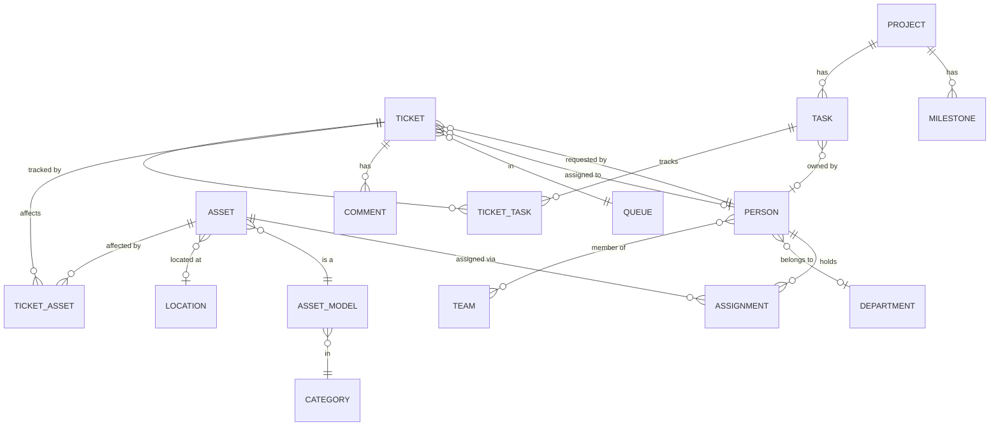
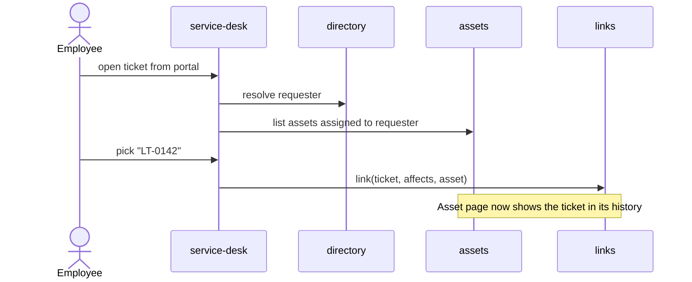
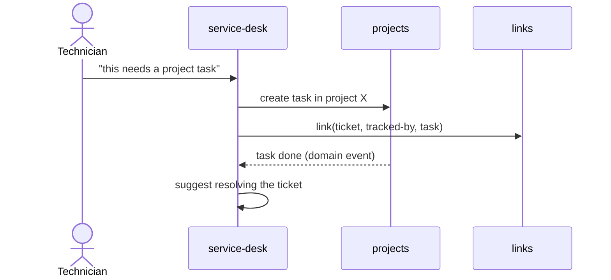
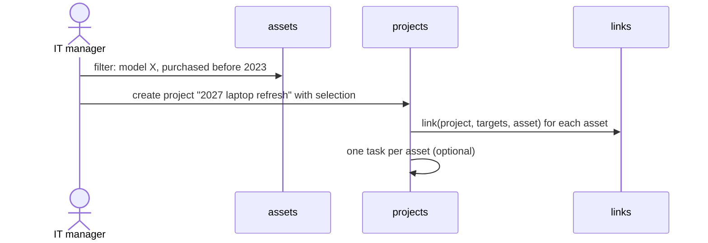

# Domain model

Draft. Names here become folder names in `src/lib/server/<domain>/` (see [ADR 0002](adr/0002-server-modules-by-domain.md)).

## Domains

| Domain         | Owns                                                                                 |
| -------------- | ------------------------------------------------------------------------------------ |
| `directory`    | `Organisation`, `Person`, `Team`, `Department`, `Location`                           |
| `assets`       | `Asset`, `AssetModel`, `Category`, `Manufacturer`, `Custody`; later `Kit`, `License` |
| `service-desk` | `Ticket`, `Queue`, `Comment` (public / internal); later `CannedResponse`, `Sla`      |
| `projects`     | `Project`, `Task`, `State` + `StateGroup`; later `Milestone`                         |
| `links`        | the pairwise join tables and the uniform read facade over them                       |
| cross-cutting  | `ActivityLog`, `Attachment`, global search                                           |

`directory` is the only domain everyone depends on. The other three domains do not import each other's tables; they relate through `links`.

`Organisation` exists so the schema is tenant-ready while exactly one row is used: every aggregate root carries `organisation_id` ([ADR 0004](adr/0004-tenancy.md)).

`State` carries a user-chosen name and a system-owned `StateGroup` (`backlog`, `unstarted`, `started`, `completed`, `cancelled`). That split is how a catalogue stays configurable while the structure does not — the shape Plane uses.

`CustomField` is deliberately absent: it is post-v1 in the [roadmap](roadmap-v1.md).

## Core entities

## Cross-domain relations

One join table per pair, each with real foreign keys, all owned by `links`
([ADR 0005](adr/0005-single-suite-and-relations.md)):

| Table           | Relation                 | Meaning                                   | Tier    |
| --------------- | ------------------------ | ----------------------------------------- | ------- |
| `ticket_asset`  | ticket `affects` asset   | The ticket is about this device           | MVP     |
| `ticket_task`   | ticket `tracked-by` task | The ticket's resolution is a project task | MVP     |
| `project_asset` | project `targets` asset  | The asset is in the project's scope       | post-v1 |

Each row also carries `createdBy` and `createdAt`, so a relation can be attributed like any
other record.

`links` exposes one read function, `relatedTo(record)`, which is what the design system's
`RecordRef` and `RelatedRecords` components consume. **The interface is uniform; the storage
is not** — and conflating those two is what makes polymorphic link tables look inevitable.

The guarantee this buys: the database cannot hold a ticket pointing at an asset that does
not exist. No foreign key can protect a column that sometimes means `assets` and sometimes
`tasks`, which is why the earlier polymorphic draft was dropped.

## Key cross-domain flows

### Ticket about a device

### Ticket escalated to project work

### Refresh project from inventory

