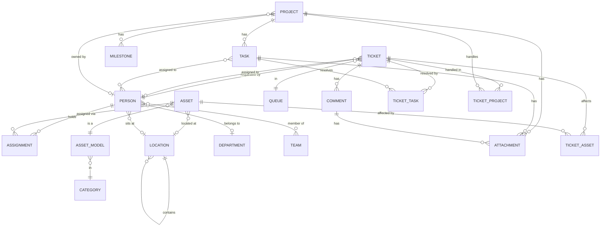
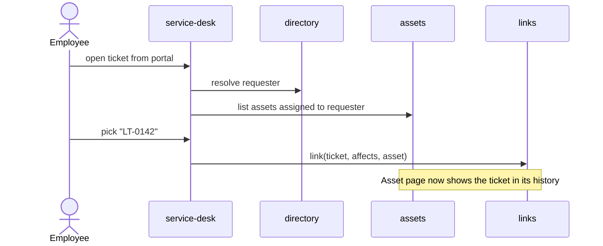
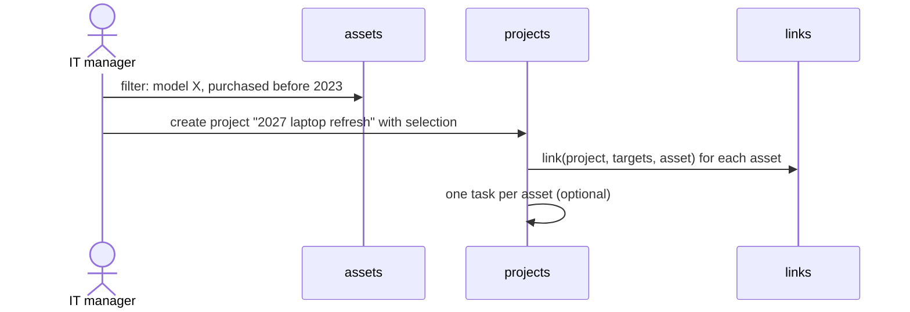

# Domain model

Draft. Names here become folder names in `src/lib/server/<domain>/` (see [ADR 0002](adr/0002-server-modules-by-domain.md)).

## Domains

| Domain         | Owns                                                                                                                 |
| -------------- | -------------------------------------------------------------------------------------------------------------------- |
| `directory`    | `Organisation`, `OrganisationBranding`, `BrandAsset`, `Person`, `Team`, `Department`, `Location`                     |
| `assets`       | `Asset`, `AssetModel`, `Category`, `Manufacturer`, `Custody`, `Handover`, `HandoverTemplate`; later `Kit`, `License` |
| `service-desk` | `Ticket`, `Queue`, `RequestForm`, `Comment` (public / internal); later `CannedResponse`, `Sla`                       |
| `projects`     | `Project`, `Task`, `State` + `StateGroup`; later `Milestone`                                                         |
| `knowledge`    | `Space`, `Page`, `PageRevision`                                                                                      |
| `links`        | the pairwise join tables and the uniform read facade over them                                                       |
| `api`          | `ApiKey`, `ServiceAccount`; the `/api/v1` endpoint registry                                                          |
| cross-cutting  | `ActivityLog`, `Notification`, `Follow`, `Attachment`, global search                                                 |

`directory` is the only domain everyone depends on. The other domains do not import each other's tables; they relate through `links`.

The **brand** is how an organisation presents the product: its product name, colour and logos ([ADR 0026](adr/0026-per-organisation-branding.md)). A brand is **customised** when it differs from Unitati's default; from then on Unitati's own art never shows, and a text wordmark and a monogram stand in until logos are uploaded. A **brand asset** is one processed image in a slot: the admin uploads the `lockup`, `lockup_dark` and `mark`; the `favicon` and `apple_touch` icons are **derived** from the mark and never uploaded. Only the processed output is stored. **Powered by** is the fixed attribution to Unitati shown beside a customised brand; it cannot be turned off.

A **location** is a place, nested without types: a building contains floors, a floor contains rooms ([ADR 0027](adr/0027-locations-hierarchy-coordinates-and-deletion.md)). Its **path** (`Barcelona office › Floor 1`) is how it is shown, because a name is only unique among siblings. Its **code** (`BCN-1`) is a short identifier unique in the whole organisation, and it may have coordinates, both latitude and longitude or neither. An asset's location cannot be deleted from under it; a person's can, and the person's activity records it.

A person's location is where they usually work: one per person, any node of the tree. It is informative and independent of the custody of their assets, and Unitati owns it whatever channel wrote it. Only `people.manage` changes it, and every change is recorded as `person.location.changed`.

**Custody** is who holds an asset now: a fact a technician records, one holder at a time. A **handover** is the holder's signed statement about a custody change ([ADR 0035](adr/0035-handover-evidence-and-signing-tokens.md)): one person, one **direction** (`delivery` or `return`) and every asset of that operation. It is `pending`, `accepted`, `rejected` or `waived`, and a pending one past its expiry is **expired**. A handover sits beside custody and never gates it: a rejection does not return the equipment, and a decided handover is never reopened, only replaced by a new one. The person decides it through its **signing link**, with no session: accepting takes a drawn signature, rejecting takes a reason, and the decision consumes the link. It is required when one of its assets is in a category that **requires handover**; **waiving** it takes a permission and a reason. Its **document** is the PDF generated once when it is decided ([ADR 0036](adr/0036-handover-document-generated-once-and-stored.md)). _Avoid_: acceptance, acknowledgement, receipt, checkout, delivery note. A **handover template** is the agreement text for one direction, global or overriding it for one category; every edit appends a version, and a handover keeps the exact text it was signed against.

An asset's **label** carries a QR that encodes `{public address}/s/{tag}`. That **scan route** is a contract that never changes: it resolves the tag for whoever is scanning, sends a signed-in viewer to the asset (or a 404 if they may not see it) and an anonymous one to the login, which returns to it ([ADR 0038](adr/0038-asset-labels-and-the-scan-route.md)).

An **attachment** is a file that belongs to exactly one owner: a ticket **comment**, a **project** or a **task**. Each owning domain keeps its own table and writes the bytes through the shared store ([ADR 0039](adr/0039-attachments-per-owning-domain.md)); an attachment has no code, no page and no existence apart from its owner. Limits are the same everywhere: 5 files per submission, 10 MiB each. It is downloaded, never previewed.

`Organisation` exists so the schema is tenant-ready while exactly one row is used: every aggregate root carries `organisation_id` ([ADR 0004](adr/0004-tenancy.md)).

`State` carries a user-chosen name and a system-owned `StateGroup` (`backlog`, `unstarted`, `started`, `completed`, `cancelled`). That split is how a catalogue stays configurable while the structure does not — the shape Plane uses. The group is fixed when a state is created and never changes; code depends on the group, never on the name. A `Task` sits in exactly one `State`, and its board column is ordered by a fractional `position`.

A project is **archived** rather than deleted, and an archived project (with its tasks) is read-only. A task has **assignees** — any number of people — and a project has at most one owner.

A project has a **visibility**: `organisation` (everyone whose role reads projects) or `members`. A members-only project and its tasks are visible only to its **members** — a list of people kept in `project_members` — and to admins; to everyone else they do not exist (`not_found`, never a 403). The owner and admins manage the list; the owner is always a member; assigning a task to a non-member is refused instead of granting access ([ADR 0041](adr/0041-per-project-visibility.md)).

The knowledge base is the one place the organisation writes documentation (#17, which absorbed #49). A **space** is a top-level container of pages, and the boundary of who may read them: its **audience** is `staff` (technicians and admins) or `portal` (employees too), and every page in it shares that audience; a page has no audience of its own. A space also carries a name, a description, an icon and a colour, each picked from a fixed set. Admins maintain spaces as a catalogue and may change a space's audience; a space with pages is archived, never deleted. Moving a page to another space moves its subtree, and when the audiences differ that move changes who can read every page in it. A **page** is one node of a space's tree: a page may hold prose, child pages, or both, and its siblings are ordered by hand through a fractional `position`. _Avoid_: article, doc, wiki page, note. A page is identified by its **code** (`DOC-0012`), generated and, unlike other record codes, never editable, because pages link to one another by it. Titles need not be unique, not even among siblings. A page is a **draft**, **published** or **archived**; it is never deleted, archiving a page archives its subtree, and a published page cannot sit under a draft. Draft is only the state of a page that has never been published: every staff member sees drafts, employees never do, and saving a published page publishes the change at once. Every save appends a **page revision**, an immutable copy of the content; restoring one appends a new revision, and a save based on a revision that is no longer the latest is refused rather than overwriting someone else's edit. Only technicians and admins write pages.

A **queue** is who works a ticket; a **request form** is what the employee asked for ([ADR 0037](adr/0037-request-forms-not-ticket-types.md)). A request form is a configurable entry the portal offers, with a name, a target queue and a system-owned **kind** (`equipment` first) that decides its fields and how it is fulfilled. A ticket filed through one remembers it; staff-created tickets have none. _Avoid_: ticket type, request type, catalogue item.

A ticket **cites** a page when a reply links it or a technician adds it to the ticket. A public reply cites only published pages of `portal` spaces; an internal note, any published page its author can read. Removing the link from the text keeps the citation. A requester whose cited page is no longer readable to them sees its code and nothing else, not even the title.

A **service account** is an organisation-owned API principal with the technician or employee role and no `Person` ([ADR 0022](adr/0022-api-layer-and-api-keys.md)). It is disabled, never deleted, because the `ActivityLog` entries it wrote name it as their actor (a row has a person, a service account, or neither for the system, never both).

An **import** is a bulk entry of records from a CSV file (#21, [ADR 0034](adr/0034-csv-import.md)). It is not an entity: nothing is stored about the import itself, and the records it creates are ordinary records, marked `via: 'import'` in their activity.

`CustomField` is deliberately absent: it is post-v1 in the [roadmap](roadmap-v1.md).

A **notification** is a line in one person's inbox saying that something concerns them: an assignment, a reply, a mention ([ADR 0040](adr/0040-transactional-notifications.md)). It targets a _person_, points at exactly one ticket, task or project, and freezes a snapshot of the code and title when it is written. It is written inside the transaction of the change that caused it. A **follow** is a person's standing interest in a record; it is stored from #301 but written from #57.

## Core entities



## Cross-domain relations

One join table per pair, each with real foreign keys, all owned by `links`
([ADR 0005](adr/0005-single-suite-and-relations.md)):

| Table             | Relation                       | Panel label     | Meaning                                                     | Tier    |
| ----------------- | ------------------------------ | --------------- | ----------------------------------------------------------- | ------- |
| `ticket_asset`    | ticket `affects` asset         | _Affects_       | The ticket is about this device                             | MVP     |
| `ticket_task`     | ticket `resolved-by` task      | _Resolved in_   | A task carries the work that resolves the ticket            | MVP     |
| `ticket_project`  | ticket `handled-in` project    | _Handled in_    | The ticket is attended within this programme of work        | MVP     |
| `project_asset`   | project `targets` asset        | _Targets_       | The asset is in the project's scope                         | post-v1 |
| `ticket_page`     | ticket `cites` page            | _Documentation_ | A reply pointed at the page; it may not resolve it          | v1      |
| `project_page`    | page `documents` project       | _Documentation_ | The page is part of the project's documentation             | v1      |
| `ticket_handover` | ticket `fulfilled-by` handover | _Handover_      | The handover delivers or collects what the ticket asked for | v1      |
| `ticket_category` | ticket `requests` category     | _Requested_     | An equipment request asks for an asset of this category     | v1      |

Each row also carries `createdBy` and `createdAt`, so a relation can be attributed like any
other record. Every one of these tables carries a **composite unique constraint on its pair**:
merge and split ([#20](../../issues/20)) moves a losing record's links onto the winner, and
without the constraint a link the winner already held lands twice.

The **Relation** column is domain vocabulary, not schema. There is no `kind` column: ADR 0005
made the relation _be_ the table, so a verb here names a meaning for people and for panel
labels, never a value stored in a row. Looking for `kind` in the database is looking for
something that was deliberately removed.

A ticket escalates to a task _and_ to a project because those answer different questions —
_"what work resolves this"_ versus _"what programme is this attended under"_. The second exists
because a request that justifies a whole project has no task to point at yet. See the
[amendment to ADR 0005](adr/0005-single-suite-and-relations.md#amendment-2026-10-07-ticket--project)
for the products this was checked against.

`links` exposes one read function, `relatedTo(record)`, which is what the design system's
`RecordRef` and `RelatedRecords` components consume. **The interface is uniform; the storage
is not** — and conflating those two is what makes polymorphic link tables look inevitable.

The guarantee this buys: the database cannot hold a ticket pointing at an asset that does
not exist. No foreign key can protect a column that sometimes means `assets` and sometimes
`tasks`, which is why the earlier polymorphic draft was dropped.

## Key cross-domain flows

### Ticket about a device



### Ticket escalated to project work

```mermaid
sequenceDiagram
    actor T as Technician
    participant SD as service-desk
    participant P as projects
    participant L as links
    T->>SD: "this needs project work"
    SD->>P: create or pick a task, or pick a project
    SD->>L: link(ticket, resolved-by, task) or link(ticket, handled-in, project)
    Note over SD,L: The ticket keeps its status; escalating changes nothing else
    L-->>SD: relation renders live — the task shows today's state
    P-->>SD: task reaches a completed state → email the assigned technician
```

The ticket is not moved, closed or reassigned by escalating: any automatic change would lie
about who is waiting on whom. The technician sees the linked task's **current** state on the
ticket, because relations render live while activity renders the past
([ADR 0009](adr/0009-activity-log.md)). When that state enters the `completed` group the
assigned technician is emailed — the one staff-facing notification in the MVP, and one that
[#33](../../issues/33) must make preferable once a notification centre exists.

### Refresh project from inventory


